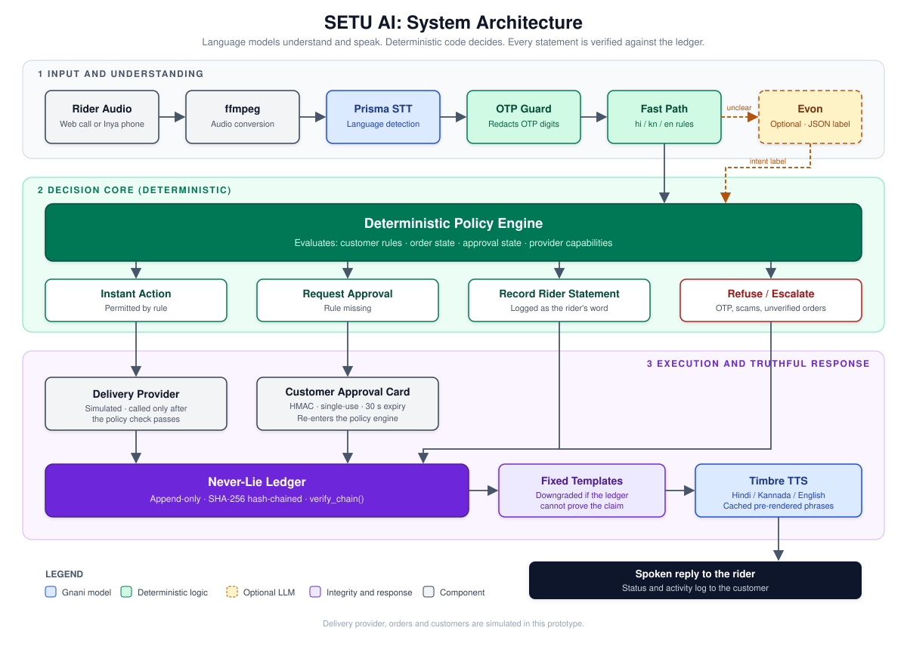

# SETU AI

### Multilingual Delivery Call Assistant: Live Interpretation and a Policy-Governed AI Agent


**Live demo:** [Rider screen](https://setu-gnani-ai.onrender.com/call) · [Customer screen](https://setu-gnani-ai.onrender.com/customer) · [Developer console](https://setu-gnani-ai.onrender.com/console)

> The demo runs on a free Render instance, which sleeps after about 15 minutes of inactivity. Open the link and allow up to a minute for the first load.

---

## Table of Contents

1. [Overview](#1-overview)
2. [Problem Statement](#2-problem-statement)
3. [Key Features](#3-key-features)
4. [Safety and Security Design](#4-safety-and-security-design)
5. [System Architecture](#5-system-architecture)
6. [Technology Stack](#6-technology-stack)
7. [Getting Started](#7-getting-started)
8. [Configuration](#8-configuration)
9. [Deployment](#9-deployment)
10. [Usage](#10-usage)
11. [Voice Pipeline](#11-voice-pipeline)
12. [Live Interpretation](#12-live-interpretation)
13. [Telephony Integration (Gnani Inya)](#13-telephony-integration-gnani-inya)
14. [Supported Scenarios](#14-supported-scenarios)
15. [Demonstration Guide](#15-demonstration-guide)
16. [Testing](#16-testing)
17. [Benchmark: DoorstepBench](#17-benchmark-doorstepbench)
18. [Project Structure](#18-project-structure)
19. [Documentation](#19-documentation)
20. [Disclaimer](#20-disclaimer)

---

## 1. Overview

**SETU AI** (*Setu* is the Sanskrit word for "bridge") is a voice assistant that mediates telephone calls between delivery riders and customers. It addresses two failure modes that commonly occur during last-mile delivery calls:

| Failure Mode | SETU AI Response |
|---|---|
| **Language barrier.** The rider and the customer do not share a language (for example, Kannada and Hindi or English). | When the customer answers, SETU provides **live, bidirectional interpretation**. Each utterance is recognised, translated into the listener's language and spoken aloud, while the original words are displayed on screen. |
| **Customer unavailable.** The customer cannot take the call (in a meeting, driving, or in class). | SETU's **AI agent** answers on the customer's behalf. It understands Hindi, Kannada, English and code-mixed speech, acts strictly within rules the customer defined in advance, requests approval through a silent one-tap notification when a rule is missing, and reports precisely what occurred. |

In both modes, the one-time password (OTP) is never spoken or translated, and no outcome is confirmed unless it has actually taken place.

> This repository is a prototype developed for the **Great Indian AI Internship Challenge** organised by Gnani AI. All components other than Gnani's models (delivery provider, orders, customers and addresses) are **simulated**.

## 2. Problem Statement

Delivery riders frequently call customers to coordinate handover. These calls fail when the parties lack a common language, when the customer is unreachable, or when the rider requests sensitive information such as an OTP. Automating the call introduces its own risks: a language model that makes unsupervised decisions, or a system that reports a delivery outcome it cannot prove, causes direct harm to the customer.

SETU AI is designed around one principle: **language models understand and speak; deterministic software decides; and every statement made to a person is verified against an immutable record.**

## 3. Key Features

- **Live bidirectional interpretation** between the rider and the customer in Hindi, Kannada and English.
- **Autonomous call handling** when the customer does not answer, with support for code-mixed speech.
- **Customer-defined rules** that govern what the agent may permit, such as leaving a parcel with a guard or neighbour.
- **Silent one-tap approvals.** Where a rule is missing, the customer receives a card with the options *Approve*, *Do not allow* and *Contact me later*.
- **OTP protection.** OTP requests are refused in every language and phrasing, and OTP-like digits are redacted before logging, storage or model exposure.
- **Never-Lie Ledger.** A tamper-evident, hash-chained activity record from which all customer-facing messages are derived.
- **Safe failure handling.** Provider outages, rejections and malformed responses always end in a safe, truthful outcome.
- **Telephony support.** Real phone calls can be placed through the Gnani Inya platform.
- **Offline-capable demonstration mode** with pre-recorded voice assets in all three languages.

## 4. Safety and Security Design

| Risk | Control |
|---|---|
| A rider or third party requests the OTP. | Refused in every language and phrasing. The OTP can never be approved by the customer. OTP-like digits are redacted before they are logged, stored or passed to a model. |
| A language model makes an unauthorised decision. | A **deterministic policy engine** decides every permission. The language model (Evon) may only label an ambiguous utterance, returning schema-validated JSON. |
| Handover is requested for an order that requires verification. | The request is refused. The guard and neighbour options are never presented to the customer. |
| A customer approval is forged or replayed. | Approvals use HMAC-signed, single-use tokens bound to the call, order and action, with a 30-second expiry and a nonce. |
| The system reports an outcome that was not confirmed. | Customer messages are **fixed templates** selected from the Never-Lie Ledger. Any template that claims more than the ledger can prove is automatically downgraded. |
| The activity record is altered. | The ledger is append-only and SHA-256 hash-chained. The database rejects `UPDATE` and `DELETE`, and `verify_chain()` detects modification. |
| The delivery provider is unavailable, rejects a request, or returns invalid data. | Every failure path informs the rider and the customer, writes a ledger event, and never reports a false success. |

## 5. System Architecture

<p align="center">
  
</p>

The system is organised into three layers: **input and understanding**, a **deterministic decision core**, and **execution and truthful response**. Models are used only to hear, label and speak; they never decide permissions.

**Processing flow**

1. Rider audio is converted with ffmpeg and transcribed by Prisma, which also detects the language.
2. The transcript is passed through the OTP guard, which redacts sensitive digits.
3. A rule-based fast path classifies the utterance in Hindi, Kannada or English. Only utterances it cannot classify are sent to Evon, which returns a label as schema-checked JSON.
4. The policy engine evaluates the intent against customer rules, order state, approval state and provider capabilities, and returns one of: *instant action*, *request approval*, *record rider agreement*, or *refuse / escalate*.
5. The outcome is written to the Never-Lie Ledger. A fixed response template is selected from the ledger and spoken by Timbre, using pre-rendered audio where available.

## 6. Technology Stack

| Layer | Technology |
|---|---|
| Backend | Python 3.11+, FastAPI |
| Speech-to-text | Gnani **Prisma v3.0** (REST short-clip endpoint, `hi-IN`, `kn-IN`, `en-IN`, `format=codemix`, `keyterms`) |
| Text-to-speech | Gnani **Timbre v2.5** (beta; voices Nalini, Saanvi, Kaveri). Kannada falls back to English, then Hindi, with the fallback logged. |
| Intent labelling (optional) | Gnani **Evon v3.3**, run locally (`EVON_MODE=local`) against a self-hosted server. Disabled by default. |
| Telephony | Gnani **Inya** |
| Translation (optional) | AI4Bharat **IndicTrans2**, alongside a built-in set of reviewed doorstep phrases |
| Audio processing | ffmpeg |
| Storage | Database with append-only, hash-chained ledger |
| Frontend | Vanilla HTML, CSS and JavaScript (no build step) |
| Offline voice assets | Piper and AI4Bharat voices |

## 7. Getting Started

### 7.1 Prerequisites

- Python 3.11 or later
- ffmpeg
- A Gnani API key (optional; required only for live Prisma and Timbre voice)

### 7.2 Installation

```bash
pip install -r requirements.txt
cp .env.example .env
```

Edit `.env` to set `GNANI_API_KEY` and `MOCK_VOICE=0` for real Gnani voice.

### 7.3 Verify Credentials (Optional)

```bash
python live_check.py
```

This validates the configured key against Prisma and Timbre.

### 7.4 Run the Application

```bash
python run.py
```

The application is served at **http://127.0.0.1:8000**.

### 7.5 Running on Two Physical Devices

To use two phones on the same Wi-Fi network:

```bash
python run.py --lan --https
```

Open the printed `https://<your-ip>:8000/call` on the rider's device and `/customer` on the customer's device. Accept the certificate warning once; mobile browsers permit microphone access only over HTTPS.

## 8. Configuration

All settings are read from environment variables. Copy `.env.example` to `.env` for local use; on a hosting platform, set them in its dashboard. **Never commit `.env` or any API key to version control.**

| Variable | Purpose | Default |
|---|---|---|
| `MOCK_VOICE` | `1` uses built-in recordings and no network; `0` uses live Gnani voice | `1` |
| `GNANI_API_KEY` | API key for Prisma and Timbre | empty |
| `GNANI_BASE_URL` | Gnani API base URL | `https://api.vachana.ai` |
| `PRISMA_MODEL`, `PRISMA_LANGUAGE_CODE`, `PRISMA_FORMAT` | Speech-to-text model, language list and output format | `prisma-v3.0`, `hi-IN,kn-IN,en-IN`, `codemix` |
| `PRISMA_USE_KEYTERMS`, `PRISMA_TIMEOUT_S` | Keyterm boosting and request timeout | `1`, `15` |
| `TIMBRE_MODEL` | Text-to-speech model | `timbre-v2.5` |
| `TIMBRE_VOICE_HI` / `_KN` / `_EN` | Assistant voices | Nalini / Saanvi / Kaveri |
| `TIMBRE_RIDER_VOICE_HI` / `_KN` / `_EN` | Rider voices used in solo demo playback | Deepak / Kavin / Pranav |
| `EVON_MODE` | Intent labelling: `off`, `api` or `local` (self-hosted server) | `off` |
| `TRANSLATE_MODE` | Translation backend: `phrases`, `model` or `both` | `both` |
| `INTERPRET_RING_S` | Seconds the customer's phone rings before the AI agent answers | `20` |
| `APPROVAL_SECRET` | Secret used to sign approval tokens. **Must be a long random value in any deployment.** | placeholder |
| `APPROVAL_TTL_S` | Approval token lifetime in seconds | `30` |
| `DB_PATH`, `PHRASE_CACHE_DIR` | Database file and phrase-cache directory | `data/deliverysaathi.db`, `data/phrase_cache` |
| `INYA_API_KEY`, `INYA_BASE_URL`, `INYA_BOT_ID`, `INYA_ENVIRONMENT`, `INYA_BRIDGE_TOKEN`, `INYA_ORDER_ID`, `INYA_WAIT_S`, `CALL_TO_NUMBER`, `CALL_COUNTRY_CODE` | Real phone call integration (see [Section 13](#13-telephony-integration-gnani-inya)) | empty |

## 9. Deployment

SETU AI ships with a `Dockerfile` and can be deployed to any container host. Phones allow microphone access only over HTTPS, so a hosted deployment with a valid certificate is the recommended way to demonstrate the voice features on real devices.

### 9.1 Run with Docker

```bash
docker build -t setu-ai .
docker run --rm -p 8000:8000 --env-file .env -e PORT=8000 setu-ai
```

The container installs Python 3.11 and ffmpeg, and starts the FastAPI application with Uvicorn on the port given by the `PORT` environment variable.

### 9.2 Deploy to Render

1. Push the repository, including the `Dockerfile`, to GitHub.
2. In Render, select **New +**, then **Web Service**, and connect the repository.
3. Configure the service:

| Setting | Value |
|---|---|
| Language | Docker |
| Branch | `main` |
| Region | Singapore (closest to India) |
| Instance type | Free for evaluation; a paid instance to avoid sleeping |

4. Under **Environment Variables**, add the variables from [Section 8](#8-configuration). At minimum set `GNANI_API_KEY`, `MOCK_VOICE=0` and a generated `APPROVAL_SECRET`.
5. Select **Deploy web service**. When the log reports that the service is live, open `https://<service-name>.onrender.com/call` and `/customer`.

Render redeploys automatically on every push to the configured branch.

### 9.3 Production Considerations

| Topic | Guidance |
|---|---|
| **Secrets** | Store keys only in the host's environment settings. Rotate any key that has been exposed in a screenshot, log or commit. |
| **Persistence** | The default database path is inside the container. On Render's free tier the disk is ephemeral, so the ledger and data reset on each deploy. Use a persistent disk on a paid plan if records must survive. |
| **Cold starts** | Free instances sleep after inactivity. Open the application shortly before a demonstration. |
| **Resources** | The optional IndicTrans2 model needs 1–2 GB of additional space and more memory than a free instance provides. Leave it disabled (`TRANSLATE_MODE=phrases`) on small instances. |
| **Single worker** | Run one application worker, as call state is held in memory. |
| **Access** | The demonstration has no user authentication. Share the URL only with intended reviewers. |

## 10. Usage

### 9.1 Application Pages

| Route | Audience | Description |
|---|---|---|
| `/call` | Rider | Call screen. Selecting **Call Asha** rings the customer's phone. If the customer answers, SETU interprets live. If not, the AI agent answers and speaks first. The interface detects when the rider stops speaking, understands Hindi, Kannada, English or a mixture, and replies by voice. |
| `/customer` | Customer | Receives incoming calls with live interpretation, shows silent approval cards, summarises what occurred, displays the hash-chained activity log, and lists the customer's rules. |
| `/console` | Developer | Console exposing the complete decision pipeline. |

### 9.2 Solo Demonstration Mode

No second participant is required. On the call screen, select **What to say** to view all 23 scenarios in the chosen language.

- **Play** runs a complete call automatically. The rider's lines are spoken in a second Timbre voice and the customer's actions occur on cue.
- **Play all** runs all 23 scenarios in sequence.
- While the customer's phone is ringing, the operator may answer as the customer directly on the call screen.

## 11. Voice Pipeline

**With a Gnani API key** (`GNANI_API_KEY` set and `MOCK_VOICE=0`): Prisma transcribes the rider with per-turn language detection and code-mixed support, and Timbre speaks every reply. Operation is hands-free: the device listens, submits a clip when the rider pauses, and plays the response.

**Without a key:** the assistant uses built-in recordings of every line in Hindi, Kannada and English, stored in `frontend/voice/` and generated offline with open Piper and AI4Bharat voices (see `tools/voicegen/README.md`). Speech recognition is provided by the browser (Google Chrome recommended); note that Chrome transmits this audio to Google. Freely typed lines fall back to the device's own voice.

**Audio troubleshooting.** Select **Test sound** before placing a call. If no audio is heard, increase the volume, confirm that output is not routed to a Bluetooth device, and on iPhone disable Low Power Mode. Audio plays even when the iPhone's silent switch is enabled.

## 12. Live Interpretation

When **Ring Asha first** is enabled (the default), selecting **Call Asha** rings the customer's device at `/customer`. The customer chooses a language (ಕನ್ನಡ, English or हिंदी) and selects **Answer with SETU translation**. Each party then speaks in their own language, and SETU translates and speaks the utterance to the other party.

If the customer selects **Let SETU's agent handle it**, or does not answer within the ring timeout (`INTERPRET_RING_S`, default 20 seconds), the AI agent takes the call.

### Translation Strategy (`TRANSLATE_MODE`, default `both`)

| Component | Description |
|---|---|
| **Doorstep phrases** (always on, offline) | A fixed, reviewed set of phrases common to deliveries, recognised in Hindi, Kannada, English or Hinglish and delivered in the listener's language, each with a built-in recording. Covered topics: arrival at the gate, locating the house, leaving the parcel with a guard, neighbour or at the door, waiting N minutes, arriving shortly, scheduling a time, traffic, customer not at home, yes and no, and thanks. |
| **Model translation** (optional, local) | Utterances outside the phrase set are sent to AI4Bharat **IndicTrans2**. Install with `pip install -r requirements-translate.txt` (approximately 1–2 GB on first use). Without it, SETU states that it could not translate and displays the original words. |
| **OTP handling** | OTP-like numbers are masked before translation. If the rider requests the OTP, the customer is advised to share it only in person. |

## 13. Telephony Integration (Gnani Inya)

SETU can place a real telephone call using Gnani's Inya platform, in which the operator acts as the rider. Inya dials a whitelisted number and carries the voice. Each utterance is posted to `/inya/turn`, where the same policy engine determines the response, and Inya speaks it back in the rider's language, switching automatically among Kannada, Hindi, English and code-mixed speech. The customer approves requests on `/customer` during the call.

```bash
python run.py --public
python call_me.py setup --public-url <url>
python call_me.py call
```

Full instructions: [docs/phone_call.md](docs/phone_call.md)

## 14. Supported Scenarios

Every scenario is tested in Hindi, Kannada and English.

| Category | Scenarios |
|---|---|
| **Call initiation** | Rider greeting · Rider at the gate, customer not answering |
| **Timing** | Customer availability enquiry · Time inside the customer's window (recorded as the rider's statement) · Time outside the window, approved by the customer |
| **Handover** | Guard, approved · Guard, declined · Neighbour, customer chooses "contact me later" · Customer does not respond in time · Neighbour, pre-approved · Order requiring verification, refused |
| **Safety** | OTP requested · Rider reads out digits (redacted before logging) · Caller claims to represent head office · Rider attempts to override the rules |
| **Directions** | Location of the house · Delivery to a different address |
| **Exceptions** | Utterance not understood twice · Delivery system rejects · Delivery system unavailable · Order not out for delivery |
| **Call completion** | Thanks and farewell · Rider disconnects before customer responds (a late approval has no effect) |

The scenario catalogue is maintained in `frontend/scenarios.json`. The test module `backend/tests/test_scenarios.py` executes every scenario in all three languages (69 calls) through the API, ensuring the interface and the test suite remain consistent.

## 15. Demonstration Guide

### 14.1 Voice Demonstration

1. Open `/call` on the rider's device and `/customer` on the customer's device. Select **हिंदी** and choose **Call Asha**. The call rings and the assistant answers: *"नमस्ते, मैं ग्राहक की ओर से… AI सहायक…"*
2. Say **"कस्टमर फोन नहीं उठा रहा। गार्ड को दे दूँ?"**. The assistant replies *"मैं ग्राहक से पूछ रहा हूँ…"* and the customer's device displays a silent approval card.
3. The customer selects **Approve**. The policy is re-evaluated, the simulated provider accepts, and the rider hears *"ग्राहक ने गार्ड को देने की अनुमति दी है…"*. The customer can read, in Kannada and English, exactly what occurred.
4. Say **"कस्टमर से ओटीपी बताओ"**. The request is refused, every time.
5. Say **"ठीक है, धन्यवाद"**. The assistant closes the call and a summary is produced.
6. Start a new call in **ಕನ್ನಡ** on order `ORD_2048` and say **"ಸೆಕ್ಯುರಿಟಿ ಗಾರ್ಡ್‌ಗೆ ಕೊಡ್ಲಾ?"**. The request is refused because the order requires verification, and no approval card is shown.

### 14.2 Sixty-Second Video Outline

| Time | Content |
|---|---|
| 0–8 s | Two phones on a table. Narration: "I'm in a meeting, and the delivery rider is calling." |
| 8–25 s | The rider's phone rings and the assistant answers in Hindi. The rider asks to leave the parcel with the guard, the customer's phone alerts, the customer approves, and the rider hears the response. |
| 25–35 s | The customer's "what happened" view in Kannada and the activity log: requested, approved, provider accepted, chain verified. |
| 35–48 s | OTP request refused. New call in Kannada on `ORD_2048` refused. |
| 48–55 s | Rider says thanks, the assistant says goodbye, and a call summary is shown. |
| 55–60 s | Closing statement: "Prisma and Timbre by Gnani. The AI never decides permissions, and never claims more than it can prove." |

## 16. Testing

```bash
python -m pytest
```

Current result: **331 passed, 1 skipped.** The skipped test is the live Gnani connectivity check, which requires an API key.

Test modules cover: policy, OTP safety, state machine, approvals, ledger, messages, fast path, voice, end-to-end flow, scenarios and benchmark.

## 17. Benchmark: DoorstepBench

DoorstepBench evaluates the system on **40 rider scripts** under five audio conditions: clean, SNR 20 dB, SNR 10 dB, SNR 5 dB and 8 kHz telephone audio.

**Metrics reported**

- Word error rate (WER), and character error rate (CER) for Kannada
- Language identification accuracy, reported separately for clips shorter than 3 seconds
- Intent accuracy, with and without Evon
- Correct-action rate
- OTP and scam refusal rate
- **False-confirmation rate** on hard cases: provider rejection, provider timeout, expired approval and rider disagreement
- Effect of keyterms (enabled versus disabled)
- Latency

The benchmark audio must be recorded by human speakers. See [benchmark/README.md](benchmark/README.md) for procedure.

## 18. Project Structure

```text
setu-gnani_ai/
├── backend/                         Application server (FastAPI)
│   ├── main.py                      Application entry point and API routes
│   ├── config.py                    Environment-driven settings
│   ├── db.py                        Database access
│   ├── seed.py                      Simulated orders and customers
│   ├── engine/                      Decision core
│   │   ├── policy.py                Deterministic policy engine
│   │   ├── state_machine.py         Call and order state transitions
│   │   ├── approvals.py             HMAC-signed, single-use approvals
│   │   ├── ledger.py                Never-Lie Ledger (hash-chained)
│   │   ├── messages.py              Fixed response templates
│   │   ├── orchestrator.py          Turn-by-turn pipeline coordinator
│   │   └── otp_guard.py             OTP detection and redaction
│   ├── intent/                      Intent understanding
│   │   ├── fast_path.py             Rule-based classifier (hi / kn / en)
│   │   ├── evon_intent.py           Optional Evon labelling
│   │   └── schema.py                Strict JSON schema for labels
│   ├── interpreter/                 Live translation
│   │   ├── phrases.py               Reviewed doorstep phrases
│   │   ├── model.py                 IndicTrans2 integration (optional)
│   │   ├── service.py               Translation service
│   │   └── routes.py                Live translated call endpoints
│   ├── telephony/
│   │   └── inya_bridge.py           Real phone calls via Gnani Inya
│   ├── voice/                       Speech input and output
│   │   ├── prisma.py                Prisma speech-to-text client
│   │   ├── timbre.py                Timbre text-to-speech client
│   │   ├── audio.py                 ffmpeg audio conversion
│   │   ├── mock_voice.py            Offline voice for no-key mode
│   │   └── phrase_cache.py          Pre-rendered phrase cache
│   ├── providers/                   Delivery provider integration
│   │   ├── base.py                  Provider interface
│   │   └── mock_delivery.py         Simulated provider
│   └── tests/                       Automated test suite (331 tests)
│
├── frontend/                        Web interface (vanilla JS, no build step)
│   ├── index.html                   Landing page
│   ├── call.html, call.js           Rider call screen
│   ├── customer.html, customer.js   Customer phone screen
│   ├── rider.html, app.js           Developer console
│   ├── style.css, phone.css         Styles
│   ├── scenarios.json               23 demonstration scenarios
│   └── voice/                       Built-in voice recordings
│
├── benchmark/                       DoorstepBench evaluation
│   ├── transcripts.csv              40 rider scripts
│   ├── make_noisy.py                Noise-condition generator
│   ├── make_8khz.py                 Telephone-quality generator
│   └── evaluate.py                  Metrics and reporting
│
├── docs/                            Documentation
│   ├── architecture.md              Detailed architecture
│   ├── safety.md                    Safety model
│   ├── limitations.md               Known limitations
│   ├── gnani_notes.md               Gnani API notes
│   └── phone_call.md                Real phone call setup
│
├── tools/
│   └── voicegen/                    Offline voice asset generation
│
├── architecture.svg / .png          System architecture diagram
├── Dockerfile                       Container image (Python 3.11 + ffmpeg)
├── requirements.txt                 Core dependencies
├── requirements-translate.txt       Optional IndicTrans2 dependencies
├── .env.example                     Configuration template
├── run.py                           Application launcher
├── live_check.py                    Gnani key verification
├── call_me.py                       Real phone call setup and dialling
├── REVIEW.md                        Review notes
└── README.md
```

### Directory Overview

| Directory | Responsibility |
|---|---|
| `backend/engine/` | All permission decisions, approvals and the tamper-evident record. No language model is involved here. |
| `backend/intent/` | Converts an utterance into an intent label. Rules first, optional Evon only when unclear. |
| `backend/voice/` | Speech-to-text, text-to-speech, audio conversion and offline fallbacks. |
| `backend/interpreter/` | Live bidirectional translation between rider and customer. |
| `frontend/` | Rider, customer and developer screens; no build step required. |
| `benchmark/` | Reproducible accuracy and safety evaluation. |

## 19. Documentation

| Document | Description |
|---|---|
| [docs/architecture.md](docs/architecture.md) | Detailed system architecture |
| [docs/safety.md](docs/safety.md) | Safety model and threat analysis |
| [docs/limitations.md](docs/limitations.md) | Known limitations |
| [docs/gnani_notes.md](docs/gnani_notes.md) | Notes on Gnani APIs and models |
| [docs/phone_call.md](docs/phone_call.md) | Real phone call setup |
| [benchmark/README.md](benchmark/README.md) | Benchmark methodology |
| [REVIEW.md](REVIEW.md) | Review notes |

## 20. Disclaimer

This software is a prototype intended for demonstration and evaluation. The delivery provider, orders, customers and addresses are simulated. Prisma, Timbre, Evon and Inya are products of Gnani AI; IndicTrans2 and the Indic voice models are products of AI4Bharat and their respective contributors.
